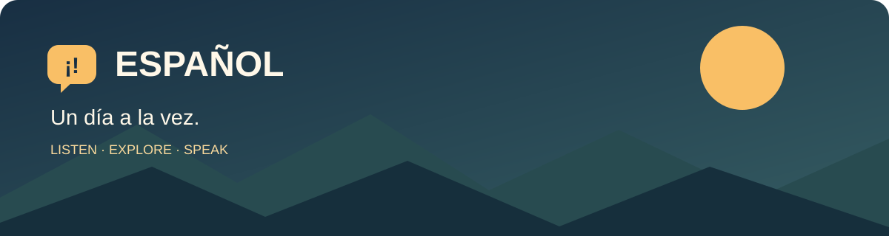

# 🇪🇸 Learn Spanish Through Immersion 🌎

**A practical guide to learning Spanish with YouTube, news, podcasts, travel, gaming and the topics you already love.**

[🌐 Explore the website](https://dmoliveira.github.io/learn-spanish-immersion/)

[Start here](#-start-here) · [Learning channels](#-learn-spanish) · [Reading](#-reading--stories) · [News](#-news--current-affairs) · [Travel](#-travel--everyday-life) · [Screen & sound](#-screen--sound) · [AI & tech](#-ai-machine-learning--technology) · [Science](#-science--discovery) · [Gaming](#-nintendo--gaming) · [Politics](#-politics--economics) · [More topics](#-more-to-explore) · [Catholicism & culture](#-catholicism-philosophy--traditional-culture) · [Practice](#-dictionaries--practice) · [Podcasts](#-listen-on-the-go) · [Routine](#-a-simple-daily-routine)

## 🚀 Start here

Pick **one learning channel and one topic you enjoy**. Start with material you mostly understand, turn on Spanish subtitles when useful, and repeat short phrases aloud. Difficulty labels below are approximate: individual videos and speakers vary.

1. 🌱 **New to Spanish?** Choose a beginner video on [Dreaming Spanish](https://www.youtube.com/@DreamingSpanish); use pictures and context to follow along.
2. 🎧 **Prefer audio?** Start with the free beginner podcast [Coffee Break Spanish: Level 1](https://coffeebreaklanguages.com/tag/cbs-season-1/); optional extras are paid.
3. 🌿 **Building confidence?** Try [Easy Spanish](https://www.youtube.com/@EasySpanish) or [How to Spanish](https://www.youtube.com/@HowtoSpanishPodcast_Official); replay a short exchange and repeat it aloud.
4. 🌳 **Ready for native content?** Pick a story from [BBC News Mundo](https://www.youtube.com/@BBCMundo) or a video about a favorite interest, then summarize it in Spanish.

Mix accents as your listening grows: this list includes voices from Spain, Mexico, Colombia, Argentina and elsewhere. Most links are free to visit; individual creators may offer paid extras, and availability or subtitles can vary.

**First five** (news and AI are more challenging for beginners): [Dreaming Spanish](https://www.youtube.com/@DreamingSpanish) · [Easy Spanish](https://www.youtube.com/@EasySpanish) · [BBC News Mundo](https://www.youtube.com/@BBCMundo) · [Luisito Comunica](https://www.youtube.com/@luisitocomunica) · [Dot CSV](https://www.youtube.com/@DotCSV)

> 💡 Portuguese speakers may recognize a lot of vocabulary. Pay special attention to pronunciation, listening, and false friends rather than assuming familiar-looking words mean the same thing.

## 📘 Learn Spanish

| # | Resource | Why watch | Starting point |
| --- | --- | --- | --- |
| 1 | [Dreaming Spanish](https://www.youtube.com/@DreamingSpanish) | Immersive stories and conversations at different levels | Beginner–advanced |
| 2 | [Easy Spanish](https://www.youtube.com/@EasySpanish) | Street interviews and everyday expressions, often with subtitles | Intermediate |
| 3 | [Spanish After Hours](https://www.youtube.com/@SpanishAfterHours) | Relaxed, comprehensible stories and daily activities | Beginner–intermediate · Spain |
| 4 | [How to Spanish](https://www.youtube.com/@HowtoSpanishPodcast_Official) | Mexican Spanish podcast and conversations about life and culture | Intermediate · Mexico |

### 📺 More learning channels

1. [Butterfly Spanish](https://www.youtube.com/@ButterflySpanish) — vocabulary, grammar and pronunciation lessons.
2. [Spanish and Go](https://www.youtube.com/@SpanishandGo) — Spanish lessons and travel-oriented conversations.
3. [Español con Juan](https://www.youtube.com/@espanolconjuan) — stories and intermediate listening practice.
4. [Why Not Spanish?](https://www.youtube.com/@WhyNotSpanish) — lessons and conversations about life and culture.
5. [Spring Spanish](https://www.youtube.com/@SpringSpanish) — practical phrases and listening lessons.
6. [The Spanish Dude](https://www.youtube.com/@elspanishdude) — explanations of grammar and common problems.
7. [SpanishPod101](https://www.youtube.com/@SpanishPod101) — short lessons and listening practice.
8. [The Language Tutor](https://www.youtube.com/@TheLanguageTutor) — structured beginner Spanish lessons.

### 📝 Courses, grammar & listening

1. [Language Transfer: Complete Spanish](https://www.languagetransfer.org/complete-spanish) — free audio course that builds patterns step by step.
2. [BBC Bitesize Spanish](https://www.bbc.co.uk/bitesize/subjects/z4dqxnb) — school-level grammar and vocabulary practice.
3. [Instituto Cervantes](https://cervantes.org/es) — Spanish language and cultural resources.
4. [StudySpanish.com](https://studyspanish.com/) — grammar explanations, pronunciation and exercises; some features may be paid.
5. [Conjuguemos](https://conjuguemos.com/) — verb conjugation and vocabulary practice.
6. [SpanishDict](https://www.spanishdict.com/) — translations, conjugations and lessons.
7. [WordReference](https://www.wordreference.com/es/en/translation.asp) — dictionary and usage discussions.
8. [RAE dictionary](https://dle.rae.es/) — definitions from the Spanish language academy.
9. [Forvo Spanish](https://forvo.com/languages/es/) — recordings by speakers from different places.
10. [Notes in Spanish](https://www.notesinspanish.com/) — conversations at several levels.
11. [Coffee Break Spanish](https://coffeebreaklanguages.com/coffeebreakspanish/) — guided audio lessons.
12. [Radio Ambulante](https://radioambulante.org/) — narrative journalism and transcripts for advanced listeners.
13. [Spanish proficiency levels: Instituto Cervantes](https://berlin.cervantes.es/es/diplomas_espanol_dele/formato_niveles_examen_dele.htm) — descriptions of DELE exams and CEFR levels A1–C2, in Spanish.
14. [Spanish Playground: Buena Gente](https://www.spanishplayground.net/spanish-video-series-buena-gente/) — short, visually supported stories for beginners; episodes and some activities are free.
15. [Spanish for False Beginners](https://www.spanishlanguagecoach.com/beginnerspanishpodcast) — beginner-friendly podcast from Spain; episodes and some transcripts are free, with paid courses available.

### 🇧🇷 Resources for Portuguese speakers

Spanish and Portuguese share many words, but similar-looking words can have different or overlapping meanings. Check the context and region before assuming a translation.

1. [Tradulex: Portuguese–Spanish false friends](https://www.tradulex.com/Glossaries/falsos_por-esp.htm) — a non-exhaustive bidirectional reference with regional notes; some older character encoding may display incorrectly.
2. [Priberam: apelido](https://dicionario.priberam.org/apelido) — a Portuguese dictionary example showing regional senses; compare with the [RAE Spanish dictionary](https://dle.rae.es/).

## 📖 Reading & stories

Choose a short text that interests you. Read once for the main idea, listen if audio is available, and note a useful phrase rather than translating every word. Levels are approximate.

1. [VideoEle: A1 videos](https://videoele.com/menu-A1.html) — beginner videos with Spanish subtitles, transcript PDFs and activities; free resources extend to B2.
2. [SpanishBOOM: texts with audio](https://spanishboom.com/spanish-texts-with-audio/) — short beginner-friendly texts, audio and English translations; the site also sells courses.
3. [The Spanish Experiment: stories](https://www.thespanishexperiment.com/stories) — familiar children's stories with Spanish narration, text and English translation; stories are not CEFR-graded.
4. [Lingua.com: Spanish reading](https://lingua.com/spanish/reading/) — graded texts and comprehension questions from A1; some readings are free, while most texts and some audio require premium.
5. [Trayectos](https://trayectosoer.org/) — free university-supported novice curriculum with online and PDF textbooks and cultural media.
6. [HablaCultura: learner texts](https://hablacultura.com/cultura-textos-aprender-espanol/) — cultural texts with audio and Portuguese glossaries for A2–C2; some full texts and activities are paid.
7. [Memoria Chilena](https://www.memoriachilena.gob.cl/602/w3-propertyvalue-137760.html) — Chilean library collections on arts, culture and history; best for confident readers.
8. [Señal Memoria](https://www.senalmemoria.co/) — Colombian public-media archive of stories, historical radio and TV; media and transcript availability vary.

## 📰 News & current affairs

Choose a mix of countries and formats to hear different accents. Native-speed reporting can be challenging: beginners can start with a short learner-friendly video and work up to headlines. Some websites have paywalls or registration; YouTube access and captions vary.

### 🌍 International & Latin America

| # | Resource | Coverage | Format |
| --- | --- | --- | --- |
| 1 | [BBC News Mundo](https://www.youtube.com/@BBCMundo) | International news and explainers | YouTube |
| 2 | [DW Español](https://www.youtube.com/@dwespanol) | World news and documentaries | YouTube |
| 3 | [Noticias Telemundo](https://www.telemundo.com/noticias) | US, Latin American and world news | Website |
| 4 | [CNN en Español](https://cnnespanol.cnn.com/) | International and regional reporting | Website |
| 5 | [France 24 en Español](https://www.france24.com/es/) | World news, analysis and live coverage | Website |
| 6 | [Euronews en español](https://es.euronews.com/) | European and international news | Website |
| 7 | [Associated Press en español](https://apnews.com/hub/ap-en-espanol) | International wire reporting | Website |
| 8 | [El País América](https://elpais.com/america/) | Latin American news and analysis | Website |
| 9 | [VisualPolitik](https://www.youtube.com/@VisualPolitik) | Commentary on international affairs and economics | YouTube |
| 10 | [El Faro](https://elfaro.net/) | Independent investigations from Central America | Website |
| 11 | [OjoPúblico](https://ojo-publico.com/) | Investigations and fact-checking from Peru and Latin America; some articles require sign-in | Website |
| 12 | [Efecto Cocuyo](https://efectococuyo.com/) | Venezuelan reporting, migration and fact-checks | Website |

### 🇲🇽 Mexico & Central America

| # | Resource | Coverage | Format |
| --- | --- | --- | --- |
| 1 | [N+](https://www.nmas.com.mx/) | Mexican and international news | Website |
| 2 | [Aristegui Noticias](https://aristeguinoticias.com/) | Mexican news and interviews | Website |
| 3 | [Animal Político](https://animalpolitico.com/) | Mexican reporting and fact-checking | Website |
| 4 | [La Nación Costa Rica](https://www.nacion.com/) | Costa Rican and international news | Website |

### 🇨🇴 Colombia, 🇦🇷 Argentina & 🇨🇱 Chile

| # | Resource | Coverage | Format |
| --- | --- | --- | --- |
| 1 | [Noticias Caracol](https://noticias.caracoltv.com/) | Colombian and world news | Website |
| 2 | [El Espectador](https://www.elespectador.com/) | Colombian news and analysis | Website |
| 3 | [La Nación Argentina](https://www.lanacion.com.ar/) | Argentine news and current affairs | Website |
| 4 | [Clarín](https://www.clarin.com/) | Argentine and international news | Website |
| 5 | [24 Horas Chile](https://www.24horas.cl/) | Chilean news and television reports | Website |
| 6 | [Cooperativa](https://cooperativa.cl/) | Chilean news and radio | Website |

### 🇪🇸 Spain

| # | Resource | Coverage | Format |
| --- | --- | --- | --- |
| 1 | [RTVE Noticias](https://www.rtve.es/noticias/) | Spanish public broadcaster news | Website |
| 2 | [El País](https://elpais.com/) | Spanish and international news | Website |
| 3 | [El Mundo](https://www.elmundo.es/) | Spanish and international news | Website |
| 4 | [eldiario.es](https://www.eldiario.es/) | Spanish news and investigations | Website |
| 5 | [La Vanguardia](https://www.lavanguardia.com/) | Spanish and international reporting | Website |

💡 **Practice tip:** Compare the same headline across two outlets or countries. Separate reporting from opinion, check dates and sources, and listen for the different words and accents used.

## 🧳 Travel & everyday life

| # | Resource | Explore |
| --- | --- | --- |
| 1 | [Luisito Comunica](https://www.youtube.com/@luisitocomunica) | Travel, food and local culture · Mexico |
| 2 | [Alan por el Mundo](https://www.youtube.com/@alanxelmundo) | Destinations, flights and travel guides · Mexico |
| 3 | [PlanetaJuan](https://www.youtube.com/@PlanetaJuan) | Travel documentaries and everyday life · Colombia |
| 4 | [Alex Tienda](https://www.youtube.com/@AlexTienda) | Destinations, documentaries and local experiences · Mexico |

### 🌎 More travel channels

1. [Molaviajar](https://www.youtube.com/@Molaviajar) — travel guides and trip planning.
2. [Lethal Crysis](https://www.youtube.com/@LethalCrysis) — travel documentaries and communities around the world.
3. [Paco Nadal](https://www.youtube.com/results?search_query=Paco+Nadal+viajes+canal+oficial) — travel stories and reporting. 🔎 Search link
4. [Clavero](https://www.youtube.com/results?search_query=Clavero+viajes+canal+oficial) — travel videos and explorations. 🔎 Search link
5. [Mochileros TV](https://www.youtube.com/results?search_query=Mochileros+TV+viajes+canal+oficial) — independent travel and destination guides. 🔎 Search link
6. [Viajeros Callejeros](https://www.youtube.com/results?search_query=Viajeros+Callejeros+viajes+canal+oficial) — travel itineraries and practical tips. 🔎 Search link
7. [Lugares que ver](https://www.youtube.com/results?search_query=Lugares+que+ver+viajes+canal+oficial) — destination ideas and travel guides. 🔎 Search link
8. [Mundo Nómada](https://www.youtube.com/results?search_query=Mundo+Nomada+viajes+canal+oficial) — travel inspiration and guides. 🔎 Search link
9. [Mariel de Viaje](https://www.youtube.com/c/MarieldeViaje) — Mexican travel vlogs and destination guides; select the original Spanish audio if a video is dubbed.
10. [RTVE: Españoles en el mundo](https://www.rtve.es/play/videos/espanoles-en-el-mundo/) — travel stories with Spaniards living abroad; playback availability can vary by region.

### 🗺️ Destination guides in Spanish

Tourism resources are useful for both planning and reading practice. Most of the links below are official tourism portals; independent or commercial magazines are identified. Check opening hours, entry rules and safety advice directly before traveling.

1. [Spain: España Fascinante](https://espanafascinante.com/) — independent cultural magazine about destinations, food and culture.
2. [Spain: Spain.info](https://www.spain.info/es/) — official tourism portal and itineraries.
3. [Colombia: Colombia Travel](https://colombia.travel/es) — destination and travel ideas.
4. [Argentina: Argentina Travel](https://www.argentina.travel/es) — official travel inspiration.
5. [Chile: Chile Travel](https://chile.travel/) — destinations and activities.
6. [Peru: Perú Travel](https://www.peru.travel/es) — cultural and nature destinations.
7. [Costa Rica: Visit Costa Rica](https://www.visitcostarica.com/es) — travel and nature information.
8. [Uruguay: Turismo Uruguay](https://uruguaynatural.com/) — destinations and experiences.
9. [Ecuador: Ecuador Travel](https://ecuador.travel/) — destination information and inspiration.
10. [Guatemala: Visit Guatemala](https://visitguatemala.gt/) — places, culture and experiences.
11. [Panama: Visit Panamá](https://www.tourismpanama.com/es/) — destination ideas and planning.
12. [Mexico: México Travel Channel](https://mexicotravelchannel.mx/) — commercial travel magazine featuring destinations, food and culture.
13. [Mexico: México Desconocido](https://www.mexicodesconocido.com.mx/) — commercial travel and culture magazine with destinations, food and traditions.

### 💬 Useful travel phrases

Try changing the words in brackets and saying each phrase aloud. These use a polite form that works in many situations.

| # | Español | English |
| --- | --- | --- |
| 1 | ¿Dónde está [la estación]? | Where is [the station]? |
| 2 | Quisiera [un café], por favor. | I would like [a coffee], please. |
| 3 | ¿Cuánto cuesta? | How much does it cost? |
| 4 | ¿Puede ayudarme? | Can you help me? |
| 5 | No entiendo. ¿Puede hablar más despacio? | I don't understand. Can you speak more slowly? |
| 6 | ¿Aceptan tarjeta? | Do you accept cards? |

## 🎭 Screen & sound

Stories, songs and everyday life make immersion more enjoyable. Most of these are native-speed content: use short clips, replay them, and choose Spanish subtitles when available. Playback rights, registration, captions and dubbed audio vary by title and country.

### 📺 TV & series

1. [Cuéntame cómo pasó](https://www.rtve.es/play/videos/cuentame-como-paso/) — RTVE's Spanish family drama across recent history; intermediate to advanced. Registration and regional availability vary.
2. [31 minutos: complete episodes](https://www.youtube.com/playlist?list=PLVI9tQggdGtFXgCwpjTM_d2pdH6ABeRFL) — Chilean puppet-news comedy with songs and visual context; fast jokes make it better for intermediate listeners.
3. [Guillermina y Candelario](https://maguare.gov.co/guillermina-y-candelario/) — Colombian children's animation about family life on the Pacific coast; visual context can help learners.

### 🎞️ Films & movies

1. [RTVCPlay: cine colombiano](https://www.rtvcplay.co/cine) — Colombian fiction and documentary films from public media; select Spanish-language titles, and note that some are limited outside Colombia.

### 🎶 Music & performances

1. [Los conciertos de Radio 3](https://www.rtve.es/play/videos/los-conciertos-de-radio-3-en-la-2/) — RTVE performances by established and emerging artists; select Spanish-language songs, as not every performance is in Spanish.
2. [Natalia Lafourcade: Hasta la Raíz](https://www.youtube.com/watch?v=tLetf-h4Y-w) — an official lyric video by the Mexican singer-songwriter; replay a chorus and follow the on-screen words.
3. [Jorge Drexler Oficial](https://www.youtube.com/channel/UCh9gFyjZsmt_Fz3QXO_5fVA) — music videos by the Uruguayan singer-songwriter; poetic lyrics can be challenging.

### 🍲 Everyday life

1. [Los puros criollos](https://www.senalcolombia.tv/general/mira-aqui-completa-cuarta-temporada-puros-criollos) — Colombian public TV explores everyday culture, including markets and food; playback may vary.
2. [De mi Rancho a Tu Cocina](https://www.youtube.com/@DemiRanchoaTuCocina) — Doña Ángela cooks traditional Michoacán dishes at home; the visual context helps with food vocabulary.
3. [La Ruta de la Garnacha](https://www.youtube.com/channel/UCUAQgUTv4-OiAClB1jYTPnA) — Mexican street food and markets; informal speech and background noise can be challenging.

## 🤖 AI, machine learning & technology

| # | Resource | Focus |
| --- | --- | --- |
| 1 | [Dot CSV](https://www.youtube.com/@DotCSV) | AI research, machine learning and generative AI |
| 2 | [Dot CSV Lab](https://www.youtube.com/@DotCSVLab) | Practical AI experiments |
| 3 | [midudev](https://www.youtube.com/@midudev) | Programming, developer tools and AI-assisted coding |
| 4 | [mouredev](https://www.youtube.com/@mouredev) | Software development and programming |
| 5 | [Platzi](https://www.youtube.com/@Platzi) | Technology, AI and data science |
| 6 | [Nate Gentile](https://www.youtube.com/@NateGentile7) | Hardware, GPUs and engineering |
| 7 | [CdeCiencia](https://www.youtube.com/@CdeCiencia) | Science and technology |
| 8 | [Xavier Mitjana](https://www.youtube.com/@XavierMitjana) | AI tools and agents |
| 9 | [Jon Hernández](https://www.youtube.com/@la_inteligencia_artificial) | AI news and business applications |
| 10 | [Ringa Tech](https://www.youtube.com/@RingaTech) | Python and machine learning |
| 11 | [Fazt](https://www.youtube.com/@FaztTech) | Software development and coding |
| 12 | [SomosNLP: NLP de 0 a 100](https://somosnlp.org/nlp-de-cero-a-cien) | Free Spanish-language NLP course; 2021 recordings are useful foundations, not current AI news |
| 13 | [Loop Infinito](https://www.xataka.com/xataka/loop-infinito-podcast-diario-xataka-tecnologia) | Xataka's technology-analysis podcast, including AI and the industry |
| 14 | [Pocho Costa: AI agents](https://pochocosta.com/podcast/como-se-arma-un-agente-de-ia-sin-programar/) | Argentine podcast episode and article about AI agents; promotes the host's training business |

## 🔬 Science & discovery

1. [QuantumFracture](https://www.youtube.com/@QuantumFracture) — physics and science.
2. [CuriosaMente](https://www.youtube.com/@curiosamente) — science, history and general knowledge.
3. [Veritasium en español](https://www.youtube.com/channel/UCXtxgWwk55kVJo9lCCZRdmg) — science and engineering.
4. [Un Mundo Inmenso](https://www.youtube.com/@UnMundoInmenso) — geography, countries and cultures.

## 🎮 Nintendo & gaming

1. [Nintendúo](https://www.youtube.com/@NintenduoESP) — Nintendo, Switch and retro games.
2. [Nintenderos](https://www.youtube.com/channel/UCcNIdhacptxZIF1zpOTUxyQ) — Nintendo news.
3. [Puerta al Sótano](https://www.youtube.com/@Dan-PuertaAlSotano) — game analysis.
4. [elrubiusOMG](https://www.youtube.com/@elrubiusOMG) — gaming and entertainment.
5. [BaityBait](https://www.youtube.com/@SrBaityBait) — gaming commentary and analysis.
6. [3DJuegos](https://www.youtube.com/@3DJuegos) — video game news and reviews.
7. [Iwata pregunta: Super Mario](https://www.nintendo.com/es-es/Iwata-pregunta/25-aniversario-de-Super-Mario-Bros-/Volumen-5-Los-desarrolladores-del-primer-Super-Mario/1-Utilizar-la-cruceta-para-saltar/1-Utilizar-la-cruceta-para-saltar-212727.html) — Nintendo's Spanish interview with the original game developers.
8. [A Link to the Podcast](https://alinktothepodcast.com/) — Spanish Nintendo podcast with interviews, indie games and retro segments.
9. [RetroManiac](https://www.retromaniacmagazine.com/) — Spanish retro-gaming articles, interviews and podcasts.

## 🏛 Politics & economics

Explore political vocabulary across perspectives. These are approximate, context-dependent descriptions, not definitive labels or endorsements. Outlets mix reporting, analysis and opinion in different proportions; compare claims and primary sources rather than treating commentary as fact.

### 🔴 Left & progressive perspectives

1. [La Base](https://www.youtube.com/results?search_query=La+Base+P%C3%BAblico+podcast) — progressive political commentary · Spain. 🔎 Search link
2. [Jacobín América Latina](https://jacobinlat.com/) — socialist analysis and essays · Latin America. Website
3. [Democracy Now! en español](https://www.democracynow.org/es) — independent progressive news and interviews · US and international. Website
4. [CTXT](https://ctxt.es/) — left-leaning political and cultural commentary · Spain. Website
5. [El Salto](https://www.elsaltodiario.com/) — Spanish cooperative publication with reporting and left-wing commentary; some content is members-only. Website

### ⚪ Center & broadly varied perspectives

These sources do not necessarily identify as centrist: they offer a range of reporting, analysis or interviews that can complement explicitly partisan commentary.

1. [BBC News Mundo](https://www.youtube.com/@BBCMundo) — international reporting and explainers.
2. [DW Español](https://www.youtube.com/@dwespanol) — news and analysis from a German public broadcaster.
3. [France 24 en Español](https://www.france24.com/es/) — international reporting and debate.
4. [El País](https://elpais.com/) — center-left-leaning Spanish newspaper with news and opinion.
5. [VisualPolitik](https://www.youtube.com/@VisualPolitik) — international affairs and economics commentary; not a neutral news wire.
6. [Chequeado](https://chequeado.com/) — Argentine fact-checking and explanatory journalism; inspect its sources and methodology. Website

### 🔵 Right, liberal & libertarian perspectives

1. [Juan Ramón Rallo](https://www.youtube.com/@juanrallo) — liberal economics · Spain.
2. [Agustín Laje](https://www.youtube.com/results?search_query=Agustin+Laje+Arrigoni+oficial) — social conservative commentary · Argentina. 🔎 Search link
3. [Libertad Digital](https://www.youtube.com/results?search_query=Libertad+Digital+oficial) — right-leaning news · Spain. 🔎 Search link
4. [La Derecha Diario](https://www.youtube.com/results?search_query=La+Derecha+Diario+oficial) — right-leaning news · Argentina. 🔎 Search link
5. [Tipito Enojado](https://www.youtube.com/results?search_query=Tipito+Enojado+oficial) — libertarian commentary and satire · Argentina. 🔎 Search link
6. [Fundación para el Progreso](https://www.youtube.com/results?search_query=Fundacion+para+el+Progreso+Chile) — classical liberal ideas · Chile. 🔎 Search link
7. [Negocios TV](https://www.youtube.com/results?search_query=Negocios+TV+oficial) — markets and interviews · Spain. 🔎 Search link
8. [ABC](https://www.abc.es/) — Spanish newspaper with a historically conservative editorial outlook; some articles require a subscription. Website

Search links are intentionally labeled: choose the official channel from the results. Political labels vary by country, issue and over time.

## 🧭 More to explore

More resources from the original watchlist. Search links are labeled; choose the intended creator from the results. Some handles have not been independently verified, and channels can move.

### 💻 Gadgets, programming & cybersecurity

1. [Topes de Gama](https://www.youtube.com/@TopesdeGama)
2. [Pro Android](https://www.youtube.com/@ProAndroid)
3. [Geek de Gafas](https://www.youtube.com/@GeekdegafasYT)
4. [clipset](https://www.youtube.com/@clipset)
5. [Tecnonauta](https://www.youtube.com/@Tecnonauta)
6. [Hola Mundo](https://www.youtube.com/@HolaMundoDev)
7. [Pelado Nerd](https://www.youtube.com/@PeladoNerd)
8. [s4vitar](https://www.youtube.com/@s4vitar)

### 💰 Economics & investing

1. [VisualEconomik](https://www.youtube.com/@VisualEconomik)
2. [Rankia](https://www.youtube.com/@Rankia)
3. [Value School](https://www.youtube.com/@ValueSchool)
4. [Economipedia](https://www.youtube.com/@Economipedia)
5. [El Arte de Invertir](https://www.youtube.com/results?search_query=El+Arte+de+Invertir+finanzas) — 🔎 Search link; several channels have similar names.

### 🌍 History & geopolitics

1. [Memorias de Pez](https://www.youtube.com/@MemoriasdePez)
2. [Academia Play](https://www.youtube.com/@AcademiaPlay)
3. [Pero Eso Es Otra Historia](https://www.youtube.com/@PeroEsoEsOtraHistoria)
4. [Descifrando la Guerra](https://www.youtube.com/@DescifrandolaGuerraYT)

### ✈️ More travel, games & science

1. [Molaviajar](https://www.youtube.com/@Molaviajar)
2. [Lethal Crysis](https://www.youtube.com/@LethalCrysis)
3. [Eurogamer Spain](https://www.youtube.com/@EurogamerSpain)
4. [Vandal](https://www.youtube.com/@Vandal)
5. [Date un Vlog](https://www.youtube.com/@DateUnVlog)
6. [Ciencia de Sofá](https://www.youtube.com/@CienciaDeSofa)
7. [El Robot de Platón](https://www.youtube.com/@ElRobotdePlaton)

### 🚗 Cars & transport

1. [coches.net](https://www.youtube.com/@cochesnet)
2. [carwow España](https://www.youtube.com/@carwowesp)
3. [Garaje Hermético](https://www.youtube.com/@GarajeHermetico)
4. [Motorpasión](https://www.youtube.com/@MotorpasionES)
5. [PowerArt](https://www.youtube.com/@GuilleGarciaAlfonsin)

### 💼 Careers & entrepreneurship

1. [Tengo un Plan](https://www.youtube.com/@TengoUnPlanPodcast)
2. [The Wild Project](https://www.youtube.com/@TheWildProject)
3. [Emprende Aprendiendo](https://www.youtube.com/@EmprendeAprendiendo)
4. [Euge Oller](https://www.youtube.com/@EugeOller)
5. [Aprendemos Juntos](https://www.youtube.com/@AprendemosJuntos)

### 🍳 Food & culture

1. [La Capital](https://www.youtube.com/@lacapitalcocina)
2. [Cocina con Coqui](https://www.youtube.com/@CocinaConCoqui)
3. [Paulina Cocina](https://www.youtube.com/@PaulinaCocina)

### 🎬 Documentaries & journalism

1. [DW Documental](https://www.youtube.com/@DWDocumental)
2. [VICE en Español](https://www.youtube.com/@VICEenEspanol)
3. [RTVE Play: Documentales](https://www.rtve.es/play/documentales/) — official documentary catalogue; availability may vary by location.

## ⛪ Catholicism, philosophy & traditional culture

A mix of Catholic teaching, news, philosophy and cultural traditions. These sources represent different voices; religious and opinion content reflects its authors' perspectives.

### 📺 Catholic channels & news

1. [EWTN Español](https://www.youtube.com/@EWTNEspanol) — Catholic television, interviews and devotional programming.
2. [ACI Prensa](https://www.aciprensa.com/) — Catholic news in Spanish.
3. [Catholic Link](https://www.youtube.com/@catholic-link) — Catholic media and faith-related discussions.
4. [Píldoras de Fe](https://www.youtube.com/@PildorasdeFe) — Catholic reflections and prayer.
5. [Fray Nelson Medina](https://www.youtube.com/results?search_query=Fray+Nelson+Medina) — talks and theological reflections. 🔎 Search link
6. [Vatican News en español](https://www.vaticannews.va/es.html) — Vatican news, audio and reporting.
7. [Rome Reports en español](https://www.romereports.com/) — reporting on the Vatican and Catholic Church.
8. [Alfa y Omega](https://alfayomega.es/) — Spanish Catholic weekly and cultural coverage.

### 📖 Faith, primary sources & prayer

1. [Santa Sede en español](https://www.vatican.va/content/vatican/es.html) — official Vatican texts and documents.
2. [Catecismo de la Iglesia Católica](https://www.vatican.va/archive/catechism_sp/index_sp.html) — Spanish edition of the catechism.
3. [Biblia de la Conferencia Episcopal Española](https://www.conferenciaepiscopal.es/biblia/) — Spanish Bible text.
4. [Ciudad Redonda](https://www.ciudadredonda.org/) — daily readings, reflections and prayer resources.
5. [Rezandovoy](https://www.rezandovoy.org/) — free Jesuit guided prayer with scripture and music.
6. [Dominicos: Evangelio del día](https://www.dominicos.org/predicacion/evangelio-del-dia/hoy/) — daily scripture readings, written reflections and video.

### 🏛️ Philosophy, history & cultural heritage

1. [Academia Play](https://www.youtube.com/@AcademiaPlay) — accessible history explainers.
2. [Memorias de Pez](https://www.youtube.com/@MemoriasdePez) — history and geopolitics.
3. [Biblioteca Virtual Miguel de Cervantes](https://www.cervantesvirtual.com/) — Spanish-language literature, history and cultural heritage.
4. [Instituto Cervantes: cultura](https://cultura.cervantes.es/) — Spanish-language cultural events and resources.
5. [Museo del Prado](https://www.museodelprado.es/) — Spanish and European art, collections and stories.
6. [UNESCO en español](https://www.unesco.org/es) — cultural heritage, traditions and education across the Spanish-speaking world.

Try a short reflection or museum story, write down a few recurring words, then describe the main idea aloud in your own words.

## 📚 Dictionaries & practice

1. [Diccionario de la lengua española (RAE)](https://dle.rae.es/) — authoritative Spanish definitions and usage.
2. [WordReference](https://www.wordreference.com/es/en/translation.asp) — Spanish–English translations and discussions.
3. [SpanishDict](https://www.spanishdict.com/) — translations, conjugations and practice.
4. [Forvo Spanish](https://forvo.com/languages/es/) — hear words pronounced by speakers from different places.

## 🎧 Listen on the go

1. [Coffee Break Spanish](https://coffeebreaklanguages.com/coffeebreakspanish/) — guided audio lessons, starting with the basics.
2. [Notes in Spanish](https://www.notesinspanish.com/) — conversations and learning materials from Spain at several levels.
3. [Radio Ambulante](https://radioambulante.org/) — narrative journalism from across Latin America, best for confident listeners; transcripts are available on its website.
4. [Duolingo Spanish Podcast](https://podcast.duolingo.com/spanish) — intermediate true stories with English narration and transcripts; a free episode archive.
5. [Charlas Hispanas](https://charlashispanas.com/) — Latin American culture, news and expressions; episodes are publicly listed, while full transcripts and exercises require premium.
6. [El hilo](https://elhilo.audio/) — Latin American news and context for confident listeners; episodes and transcripts are available online.
7. [No Hay Tos](https://www.nohaytospodcast.com/about) — Mexican Spanish podcast about life and culture for intermediate learners; some episodes contain explicit language and some full transcripts may require payment.
8. [Hoy Hablamos](https://www.hoyhablamos.com/category/podcast-aprender-espanol/) — Spanish-from-Spain podcast for intermediate and advanced learners; some recent audio is free, while the full archive, transcripts and exercises require premium.
9. [Spanish Obsessed: beginner conversations](https://www.spanishobsessed.com/beginners-spanish/) — beginner audio with some English guidance and Colombian Spanish; free episodes, with limited free transcripts and paid materials.
10. [Españolistos](https://www.espanolistos.com/) — Colombian teacher Andrea and learner Nate discuss culture and daily life in mostly Spanish; the collected transcript set requires a donation, while individual episode access can vary.
11. [Chill Spanish Listening Practice](https://www.youtube.com/channel/UCJ4YHlzG7n0R9vXJar69RTA/featured) — short learner-oriented episodes about everyday topics; caption and transcript availability varies.

Audio alone can be harder than video. Start with a short episode, use a transcript if available, and revisit it later without reading.

## ⏳ A simple daily routine

**Have 40 minutes?** Try this mix, adjusting the content to your level:

1. **10 min:** Watch a learner-friendly video from Dreaming Spanish or Easy Spanish.
2. **10 min:** Follow a story on BBC News Mundo or DW Español; beginners can use another learner-friendly video instead.
3. **15 min:** Enjoy a travel, AI, gaming or other video that interests you.
4. **5 min:** Summarize what you watched aloud; save a few useful phrases.

Use Spanish subtitles when helpful, then replay a short segment without them. On YouTube, use the **CC** button when available and the settings menu to adjust playback speed. Automatic captions can contain mistakes. Adjust the mix and speed to your level; consistency matters more than the exact timing.

**Only 10 minutes?** Watch six minutes of learner-friendly Spanish, replay two minutes, then spend two minutes saying or writing what you understood. It is fine to keep the recap to a few words.

To make phrases stick, use part of your recap to recall one from yesterday and use it in a new sentence. Revisit it again a week later.

### 🗓️ Your first week

1. **Days 1–2:** Choose a learner-friendly video and note three phrases you recognize.
2. **Days 3–4:** Replay it, say the phrases aloud, and try a short video about a favorite topic.
3. **Days 5–6:** Sample a different accent or a short podcast; look up only words you keep hearing.
4. **Day 7:** Give a one-minute recap in Spanish and choose what you want to watch next week.

### 🗓️ Keep going: a flexible four-week path

| Week | Focus | Small goal |
| --- | --- | --- |
| 1 | Comprehensible input | Choose a learner-friendly channel and collect a few useful phrases. |
| 2 | Travel and daily life | Watch a travel video, then describe a place or meal in Spanish. |
| 3 | News and different accents | Try a short news story or a second learning video; compare speakers from two regions. |
| 4 | Listening and speaking | Revisit a favorite clip or podcast and give a short recap without reading. |

Repeat a week or switch topics whenever you need to. This is a practice plan, not a promise of fluency or a substitute for conversation practice.

## 🔗 About this list

The original watchlist came from a Spanish-learning conversation and is organized here for browsing. Difficulty and topic descriptions are guides, not endorsements; creators' content and links can change. Search links are labeled, and channel handles should be checked before subscribing. If you find an outdated link or have a useful suggestion, [open an issue](https://github.com/dmoliveira/learn-spanish-immersion/issues/new).

**Contributing a link?** Prefer the creator's official Spanish-language page or channel, briefly describe its topic and level, and label search links and paid features. Check that the destination is the intended creator, not just that it opens. For local README anchors and files, contributors can run `npm ci --ignore-scripts` followed by `npm run check:links` with Node.js 22. The automated check does **not** verify external websites or their content. The [website](https://dmoliveira.github.io/learn-spanish-immersion/) is generated from this README; to preview changes, run `npm test`, `npm run build`, and `python3 -m http.server --directory dist`, then visit `http://localhost:8000/`.

## 💛 Support the project

This resource hub is free to use. If it helps your learning, you can support maintenance and future educational projects via [Stripe](https://buy.stripe.com/8x200i8bSgVe3Vl3g8bfO00). Support is optional.

---

Made for curious learners. ¡Vamos! 🌟
